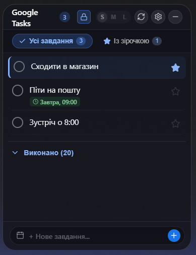
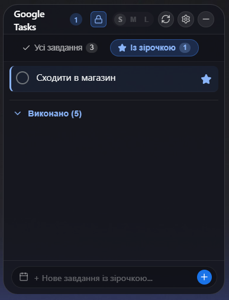

# 📱 Google Tasks Desktop Widget for Windows

Елегантний, ультралегкий (~25 MB RAM) настільний віджет для **Google Tasks** на Windows, виконаний у стилістиці **Glassmorphism / macOS** із нативним керуванням, автозапуском, системним треєм та повною синхронізацією.

<div align="center">
  
  &nbsp;&nbsp;&nbsp;&nbsp;
  
  <p><em>Вкладка «Усі завдання» з дедлайнами/часом (ліворуч) та вкладка «Із зірочкою» (праворуч).</em></p>
</div>

---

## ✨ Можливості

1. **Дизайн та ергономіка**:
   - Безрамкове прозоре вікно з плавними скругленими кутами та розмиттям фону.
   - Кнопка замка 🔒 у шапці: надійна фіксація положення та розміру (блокує перетягування та зміну розміру курсором).
   - Швидкі пресети розмірів вікна: **S (290x380)**, **M (330x460)**, **L (380x560)**.

2. **Вкладки «Усі завдання» та «Із зірочкою»**:
   - Повна підтримка розділу «Із зірочкою» як в оригінальному Google Tasks.
   - Кнопка зірочки (★ / ☆) у кожному рядку з візуальною підсвіткою активних завдань.
   - Нові завдання, створені у вкладці «Із зірочкою», автоматично позначаються зірочкою.

3. **Встановлення терміну та часу (Deadlines)**:
   - Швидкі пресети дати: «Сьогодні», «Завтра», «Через тиждень» та календарик.
   - **Вибір точного часу**: пресети `09:00`, `13:00`, `18:00`, `21:00` або вибір довільного часу.
   - Автоматичний статус «Прострочено» (червоний бейдж), коли призначений час минає.

4. **Вхід через Google в 1 клік (OAuth 2.0 Loopback)**:
   - Автоматична авторизація через браузер на локальний порт `127.0.0.1:8085` без необхідності ручного копіювання токенів.
   - Усі токени зберігаються локально на комп'ютері користувача.

5. **Офлайн-режим (Offline Sync Queue)**:
   - Якщо інтернет тимчасово недоступний, ви можете додавати, редагувати та відмічати задачі.
   - Зміни накопичуються в черзі та синхронізуються із серверами Google після відновлення з'єднання.

6. **Системний трей та автозапуск**:
   - Віджет схований з панелі завдань (`skipTaskbar`).
   - Клік по іконці в треї (біля годинника) ховає або повертає віджет.
   - Меню трею: показати/сховати, центрувати на екрані, закрити програму.
   - Налаштування автозапуску разом із Windows (запис у реєстр `HKCU\Software\Microsoft\Windows\CurrentVersion\Run`).

7. **Редагування на місці**:
   - Клікніть по тексту задачі або на іконку ✏️ для швидкого редагування (`Enter` для збереження, `Esc` для скасування).

---

## 🚀 Як зібрати та запустити

### Вимоги:
- [Node.js](https://nodejs.org/) (версія 18+)
- [Rust](https://www.rust-lang.org/) (cargo)

### Встановлення та запуск у режимі розробки:
```bash
# Встановлення залежностей
npm install

# Запуск віджета
npm run tauri dev
```

### Створення релізного бінарника:
```bash
npx tauri build --no-bundle
```
Готовий `.exe` буде створено за шляхом:
`src-tauri/target/release/tauri-app.exe` (або `google-tasks-widget.exe`).

---

## 🔒 Конфіденційність та безпека
- **Жодної телеметрії чи сторонніх серверів**: додаток спілкується виключно напряму з офіційними API Google (`tasks.googleapis.com` та `accounts.google.com`).
- **Локальне збереження**: облікові дані та налаштування зберігаються у вашому персональному локальному сховищі Windows.

---

## 📄 Ліцензія
Проєкт розповсюджується під ліцензією [MIT](LICENSE).
